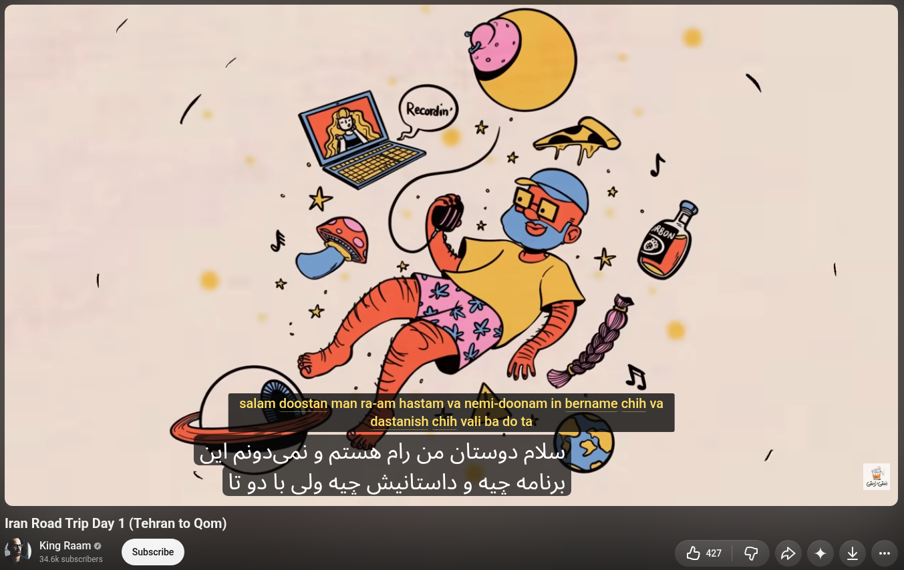
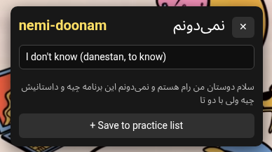
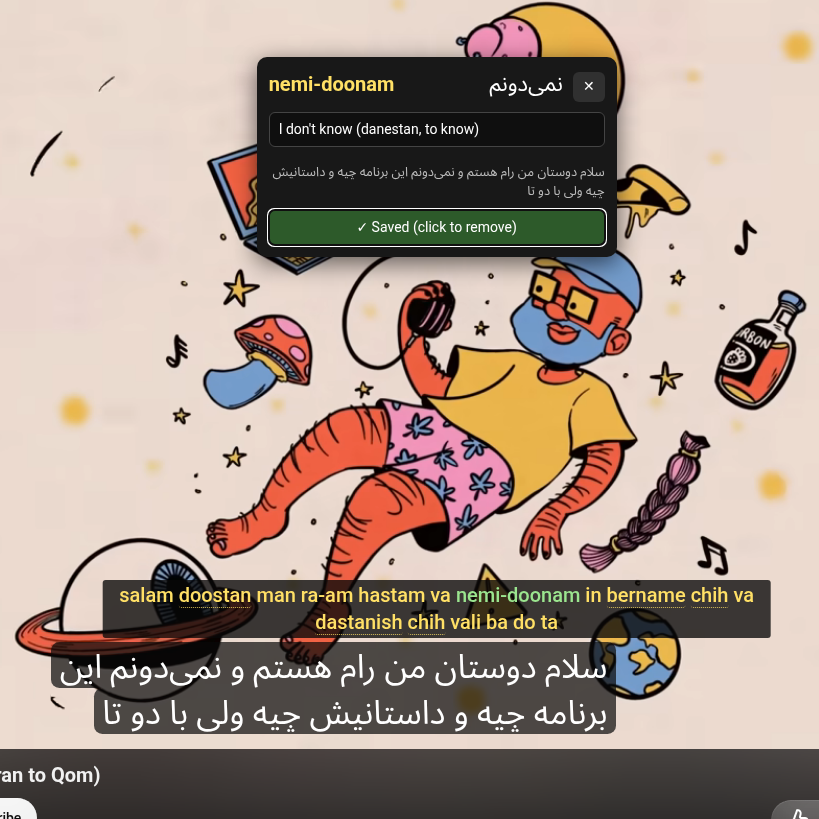
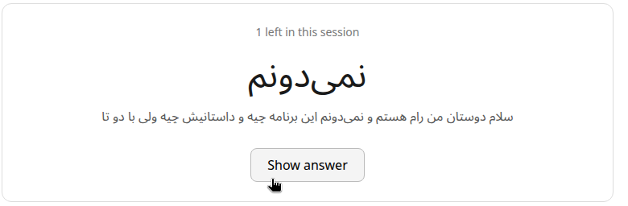
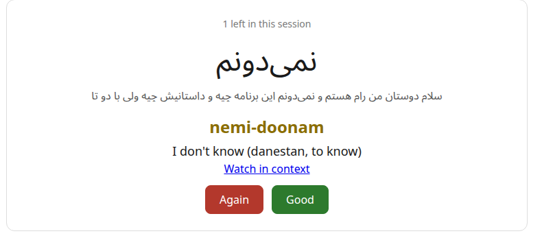

# Finglish Subs

A Chrome extension that shows Persian YouTube subtitles written in **Finglish** (Persian spoken words in Latin letters), so you can read along while learning Persian script.

- Finglish appears on top of the video, above YouTube's own captions.
- Tap any Finglish word to see its English meaning, and pause the video while you do.
- Save words to a practice list, then review them with spaced-repetition flashcards.
- Works offline. Online dictionary lookup is optional and only runs when you ask for it.

## Screenshots

Finglish subtitles over a YouTube video:

 

Tap a word to see its meaning:

 

Save it to your practice list:

 

Review your practice list with flashcards:

 

## Install

1. Download and unzip `finglish-subs.zip`.
2. Open `chrome://extensions` in Chrome, Edge or Brave.
3. Turn on **Developer mode** (top right).
4. Click **Load unpacked** and choose the unzipped `finglish-subs` folder.
5. Open a YouTube video with Persian captions (manual or auto-generated) and turn on Persian subtitles.

## Using it

| What                  | How                                                       |
| --------------------- | --------------------------------------------------------- |
| Show or hide Finglish | Alt+F on YouTube, or the switch in the toolbar popup      |
| Change text size      | Slider in the popup                                       |
| See a word's meaning  | Tap a Finglish word; the video pauses                     |
| Look up a word online | Tap "Look up meaning online" on the card (off by default) |
| Save a word           | "Save to practice list" on the card                       |
| Practise              | Popup > "Practice words"                                  |

Words with a dotted underline are spelled by a rule rather than from the built-in list, so the spelling is a best guess.

## Privacy

Everything is stored on your computer in Chrome's extension storage. The extension does not collect or send personal data. The only outside request is to en.wiktionary.org, and only when you tap "Look up meaning online" (or turn on auto-lookup). That request contains the single Persian word you tapped. See `PRIVACY.md`.

## Limits

- Only works on youtube.com, and only for videos with Persian captions.
- Finglish has no single standard spelling, so spellings are one reasonable choice, not the only one.
- Built-in meanings cover about 360 common words and about 40 verbs. Other words use the rules or the online lookup.
- YouTube changes its internals from time to time, which can break caption loading. If that happens, the extension falls back to reading the on-screen captions.

## Feedback

Words spelled wrong, meanings missing, or a broken video? Open an issue or send a note with the video link and the Persian line.

## Licence

Built-in English meanings are written for this project. Online meanings come from Wiktionary and are available under CC BY-SA; credit the source if you reuse them.
